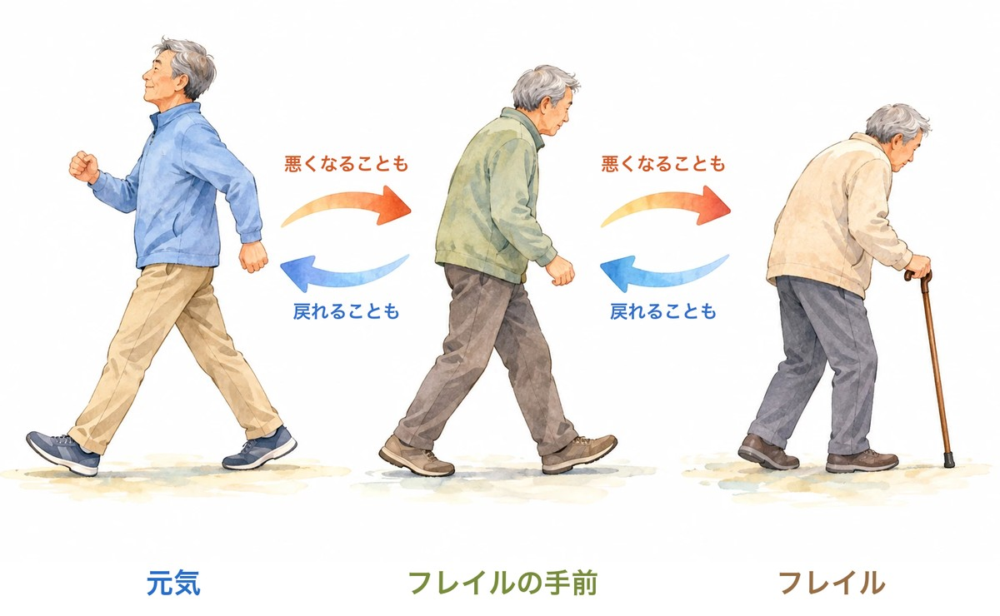

「最近、ペットボトルのふたが開けにくい」「歩くのが、前より遅くなった気がする」。

ご自分のことでも、離れて暮らす親のことでも、そんな小さな変化に気づいたことはありませんか。

こうした**体の弱り**は「フレイル（虚弱）」と呼ばれます。そして最近、**体が弱っていく人は、頭の働きも落ちやすい**ことを示す研究が、いくつか出てきました。

今回は、「**悪くなったとき**」と「**戻ったとき**」に注目した研究を3つ、短くご紹介します。

> ✅ 元気な状態から**フレイルの側へ悪化した人**は、元気なままの人にくらべて、**頭の働きの落ち方が少し速い**という結果でした
>
> ✅ 一方、**フレイルの手前から元気に戻った人**は、手前のままの人にくらべて、**認知症になった人が約4割少なかった**という研究もあります
>
> ✅ ただし、**体を鍛えるだけで頭も守れる、とまでは言えません**。くじ引きで調べた試験では、運動に「頭を使う」「食べる」を組み合わせたほうがよさそうでした

---

## 目次

1. [そもそも「フレイル」とは？](#そもそもフレイルとは)
2. [悪化すると、頭の衰えも少し速い](#悪化すると頭の衰えも少し速い)
3. [手前から戻った人は、認知症が少なかった](#手前から戻った人は認知症が少なかった)
4. [運動だけで、頭も守れるの？](#運動だけで頭も守れるの)
5. [現場で感じていること](#現場で感じていること)
6. [いま、私たちにできること](#いま私たちにできること)
7. [おわりに](#おわりに)
8. [参考にした情報](#参考にした情報)

---

## そもそも「フレイル」とは？

**フレイル**とは、**元気な状態と、介護が必要な状態の「あいだ」のこと**です。日本語では「虚弱」と訳されます。

日本では、次の5つのうち、**3つ以上当てはまるとフレイル、1〜2つならフレイルの手前**（プレフレイル）と考えます（日本版CHS基準・2020年改定）。

| チェック項目 | 目安 |
|---|---|
| 体重が減った | 6か月で2kg以上、意図せずに減った |
| 握力が弱い | 男性28kg未満、女性18kg未満 |
| 疲れやすい | ここ2週間、わけもなく疲れたような感じがする |
| 歩くのが遅い | 1秒に1m未満（横断歩道を青のうちに渡りきれないくらい） |
| 体を動かしていない | 軽い運動・体操も、定期的な運動・スポーツも、週1回もしていない |


いくつか当てはまるかも……。もう手遅れでしょうか？



いいえ。フレイルのいちばん大事な特徴は、「**戻れることがある**」ところなんです。だからこそ、**早めに気づく**ことに意味があります。


---

## 悪化すると、頭の衰えも少し速い

2026年9月に、**中国・イギリス・アメリカの約2万人**を合わせて調べた研究が発表されました（学術誌『Alzheimer's & Dementia』）。

フレイルの状態を**2年あけて2回**測り、その後**数年間、頭の働き**（記憶・今日の日付などの見当識・段取りする力）を追いかけています。

- はじめから**フレイルやその手前だった人**は、元気な人にくらべて、頭の働きが**少しずつ速く**落ちていました
- **元気な状態からフレイルの側へ悪化した人**も、元気なままの人にくらべて、同じように**少し速く**落ちていました

ただし、この研究には注意点が2つあります。

1. ここでの「フレイル」は、筋力ではなく、**持病・症状・生活の不自由・気分の落ち込みなど、健康の問題がいくつ重なっているか**で測ったものです
2. **フレイルが良くなった人で、頭の衰えがゆるやかになったかは、はっきりしませんでした**。研究者自身も「フレイルを改善すれば頭が守られる、とは示していない」と書いています

---

## 手前から戻った人は、認知症が少なかった

もうひとつ、**体の弱り**で測った研究があります（上の表のような項目で見る海外の物差しを、少し変えたものです）。2026年に発表された、**60歳以上の約1万6千人**を合わせて調べた研究です（学術誌『Journal of Advanced Research』）。

こちらも、フレイルの状態を2回測って、その「変化」と認知症の関係を見ています。

| フレイルの変化 | くらべた相手 | 認知症になった割合 |
|---|---|---|
| 元気 → 手前・フレイルに悪化 | 元気なままの人 | 約1.6倍 |
| 手前 → フレイルに悪化 | 手前のままの人 | 約1.9倍 |
| **手前 → 元気に戻った** | 手前のままの人 | **約0.6倍（約4割少ない）** |


戻った人は、認知症が少なかったんですね！



はい、希望のある数字だと思います。ただ、これも「**そういう関係が見られた**」という研究です。もともと元気になりやすい事情があった人が戻っただけ、という可能性も残ります。「**戻せば認知症を防げる**」**とまでは言えない**、というところは押さえておいてください。


---

## 運動だけで、頭も守れるの？

では、フレイルは本当に戻せるのか。戻すと、頭の働きはどうなるのか。

これを**くじ引きで調べた試験**が、シンガポールにあります。フレイルとその手前の高齢者（平均70歳）約250人を、5つの組に分けて半年間、取り組んでもらいました。

- **栄養**（栄養補助食品）の組
- **運動**の組
- **脳トレ**の組
- **全部セット**の組
- **いつもどおり**の組

**1年後、フレイルが良くなった人**は、いつもどおりの組で15%。取り組んだ組では**36〜48%**でした。とくに**運動の組と、全部セットの組**で効果が大きく、運動の組では**歩く速さ**も改善しました。

ところが、**頭の働き**を見ると、話は少し違いました。

- いちばん伸びたのは、**脳トレの組**
- 全部セットの組も、1年後に伸びていました
- **運動だけの組では、頭の働きにはっきりした効果は見られませんでした**


えっ、運動は頭に効かないんですか？



「効かない」と決まったわけではありません。250人ほどの、半年間の試験の結果です。ただ、**体を戻すには運動、頭を守るには「頭を使う」「食べる」も組み合わせる**。そう考えておくのが、いまの研究にいちばん合っていると思います。


> 運動・食事・脳トレ・仲間づくりを組み合わせる研究は、こちらでも紹介しています。
> 👉 [ひとりで頑張るのと、支えのある形で続けるのと](/posts/multidomain-group-program-2026/)

---

## 現場で感じていること

地域の活動に参加されている方には、比較的お元気な方が多いと感じます。ただ、その中でも、**年齢とともに痩せてきて、歩くのが大変になってきた方は、認知機能も低下している**印象があります。

もちろん、これは私が現場で見てきた印象です。体の弱りが先なのか、頭の衰えが先なのかまでは、私にも分かりません。ただ、今回の研究を読んで、その印象と重なるところがありました。

---

## いま、私たちにできること

- ☑ **年に1〜2回、同じ物差しで測る**……握力、横断歩道を渡りきれるか、体重。**1回の数字より、前回からの変化**を見てください
- ☑ **「手前」のうちに動き出す**……5つのうち1〜2つ当てはまる段階が、いちばん戻しやすい時期です
- ☑ **運動に、頭と食事を組み合わせる**……歩く・筋トレに加えて、人と話す・新しいことを覚える・たんぱく質をとる
- ☑ **離れて暮らす親の「変化」に気づく**……電話の声の元気さ、外出の回数、体重。帰省のたびに同じところを見ておくと、変化に気づきやすくなります

### 🤝 握力を、家で測っておきたい方へ

握力は、フレイルのチェック項目のひとつで、家でも測れます。**同じ時間帯・同じ姿勢で、年に数回**測ると、変化に気づきやすくなります。

{{< affiliate
    title="握力計（Amazon・楽天で探す）"
    amazon="https://af.moshimo.com/af/c/click?a_id=5534074&p_id=170&pc_id=185&pl_id=4062&url=https%3A%2F%2Fwww.amazon.co.jp%2Fs%3Fk%3D%25E6%258F%25A1%25E5%258A%259B%25E8%25A8%2588"
    rakuten="https://af.moshimo.com/af/c/click?a_id=5533903&p_id=54&pc_id=54&pl_id=27059&url=https%3A%2F%2Fsearch.rakuten.co.jp%2Fsearch%2Fmall%2F%25E6%258F%25A1%25E5%258A%259B%25E8%25A8%2588%2F"
    description="デジタル表示のものが読み取りやすく、おすすめです。数字は体格や測り方で変わるので、ほかの人とくらべるより、ご自分の「前回」とくらべる使い方をしてください。" >}}

### 🏋️ 体を動かす習慣をつけたい方へ

「一人ではなかなか続かない」「自分のペースで通いたい」という方は、ジムを利用するのもひとつの方法です。

PR

フィットネスジム FIT24

24時間いつでも通える、フィットネスジム。早朝でも夜でも、自分の生活リズムに合わせて体を動かせます。「決まった時間に通うのはむずかしい」という方の、運動を続けるきっかけに。

※持病のある方、体重が急に減っている方は、運動を始める前に、かかりつけ医にご相談ください。

> 握力と脳の関係は、こちらの記事でも取り上げました。
> 👉 [「にぎる力」が、脳を守る？](/posts/brain-muscle-strength-2026/)

---

## おわりに

体の弱りと、頭の衰え。どちらも、ある日いきなり来るものではなく、**少しずつ進むもの**です。

今回の研究からわかったのは、**悪くなる方向の変化には、頭の衰えもついてきやすい**こと。そして、**フレイルの手前の段階なら、元気に戻れる人がいる**ことでした。

「体を鍛えれば頭も大丈夫」とまでは、まだ言えません。それでも、**体の変化に早めに気づいて、体と頭と食事を一緒に整えていく**。それが、いまの研究から言える、いちばん確かな道すじだと思います。

---

## 参考にした情報

- Wang X ほか「Dynamic frailty exposure and cognitive aging trajectories: A multicohort study」*Alzheimer's & Dementia* 2026年;22(9):e71821（中国・イギリス・アメリカの19,586人）
- Ding Y ほか「Longitudinal dynamics in frailty and incident all-cause dementia: a multicohort study」*Journal of Advanced Research* 2026年;88:855-865（60歳以上15,897人）
- Ng TP ほか「Nutritional, Physical, Cognitive, and Combination Interventions and Frailty Reversal Among Older Adults: A Randomized Controlled Trial」*American Journal of Medicine* 2015年;128(11):1225-1236
- Ng TP ほか「Cognitive Effects of Multi-Domain Interventions Among Pre-Frail and Frail Community-Living Older Persons: Randomized Controlled Trial」*Journals of Gerontology: Series A* 2018年;73(6):806-812
- Satake S, Arai H「The revised Japanese version of the Cardiovascular Health Study criteria (revised J-CHS criteria)」*Geriatrics & Gerontology International* 2020年;20(10):992-993

※ 本記事は、上記の論文をもとに、一般読者向けにわかりやすくまとめ直したものです。紹介した研究の多くは観察研究（関係が見られたというもの）で、原因を証明したものではありません。体調に不安のある方は、かかりつけ医にご相談ください。

