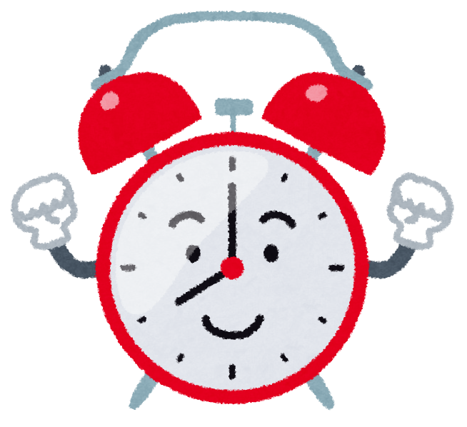
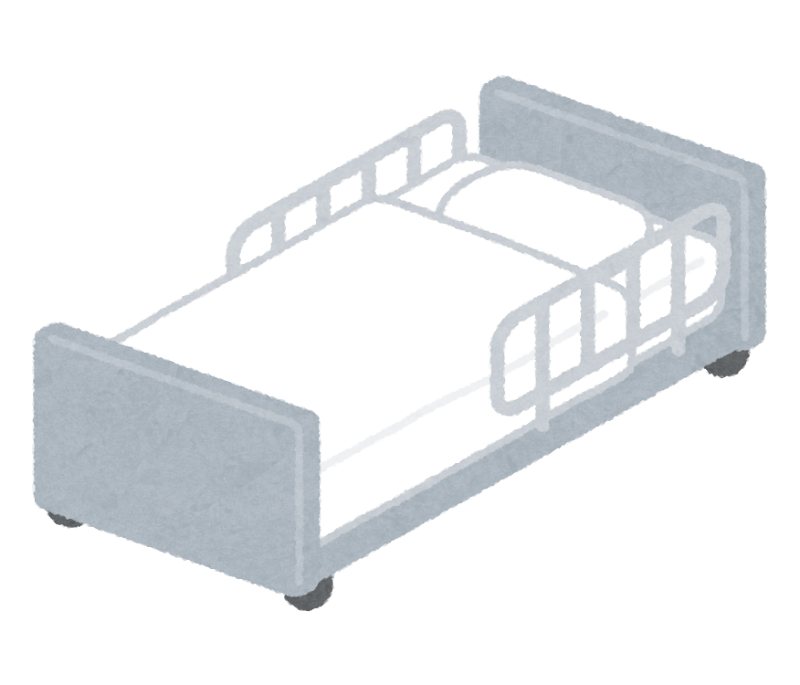
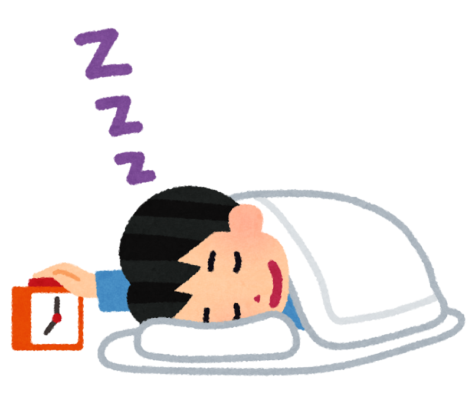
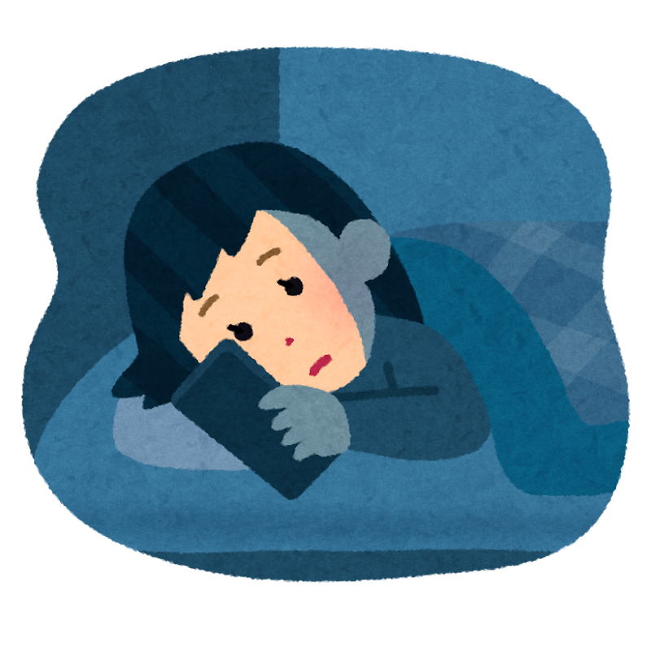

「睡眠は7時間は取りましょう」——。そんな話は、よく耳にしますよね。

では、**寝る時刻や起きる時刻が、日によってバラバラ**な場合は、どんな影響があるでしょうか。
平日は6時起き、休日は10時起き。仕事や家の用事で、寝る時間もまちまち。そんな方は、きっと多いと思います。

じつは近年、**睡眠の「長さ」だけでなく「毎日の規則正しさ」も、認知症と関係しているかもしれない**という大規模な研究が、いくつか出てきました。
今回は、その中身を、わかっていることと、まだわからないことに分けてご紹介します。

> ✅ イギリスの約8万8千人を調べた研究では、寝起きの時刻が**いちばんバラバラな人**（下位5％）は、**真ん中の人にくらべて**、認知症になる割合が **約1.5倍** だった
>
> ✅ 別の約8万2千人の研究では、**睡眠が短め（7時間未満）の人でも、リズムがそろっている人は、そうでない人にくらべて認知症が少なかった**
>
> ✅ ただし、どちらも「**そういう関係が見られた**という研究」です。バラバラな睡眠が原因だと決まったわけではありません

---

## 目次

1. [睡眠の「規則正しさ」って、どう測るの](#睡眠の規則正しさってどう測るの)
2. [研究1：寝起きがバラバラな人は、認知症が約1.5倍](#研究1寝起きがバラバラな人は認知症が約15倍)
3. [研究2：睡眠が短めでも、リズムがそろっていると](#研究2睡眠が短めでもリズムがそろっていると)
4. [ここは、慎重に読んでください](#ここは慎重に読んでください)
5. [どうして関係するの（考えられている仕組み）](#どうして関係するの考えられている仕組み)
6. [現場で感じていること](#現場で感じていること)
7. [今夜からできること（私の考えです）](#今夜からできること私の考えです)
8. [おわりに](#おわりに)

---

## 睡眠の「規則正しさ」って、どう測るの


規則正しい睡眠って、「毎日同じ時間に寝る」ってことですよね？ それって、どうやって調べたんですか？



そのとおりです。研究では、**手首につける小さな機械**（動きを記録する装置）を1週間つけてもらい、**「毎日、同じ時間帯に寝ているか・起きているか」** を数字にしています。


この数字（睡眠規則性指数＝SRI）は **0〜100点**で表されます。

- 毎日まったく同じ時間帯に寝て起きていれば、**100点に近づく**
- 日によってバラバラなほど、**0点に近づく**

ここで大事なのは、**「何時に寝るか」ではなく「毎日そろっているか」** を見ていることです。夜型でも朝型でも、毎日同じなら、点数は高くなります。

---

## 研究1：寝起きがバラバラな人は、認知症が約1.5倍

1つめは、オーストラリアのモナシュ大学などの研究で、2024年に医学誌『Neurology（ニューロロジー）』に載りました。

- 対象：**イギリスの88,094人**（平均62歳）
- 方法：1週間、手首の装置で睡眠を記録 → その後、**約7年間**（人によって追いかけた年数は違い、ちょうど真ん中の人で7.2年）追いかけた
- 結果：追跡中に認知症になったのは **480人**（全体の約0.5％）

年齢・性別・持病・遺伝（APOE ε4＝アルツハイマー型のなりやすさに関わる遺伝子）などの影響を取りのぞいて比べると——

| 比べた人 | 規則性の位置 | 認知症になる割合 |
|---|---|---|
| 真ん中の人（基準） | 真ん中 | 1倍 |
| **いちばんバラバラな人（下位5％）** | かなり不規則 | **約1.5倍**（1.53倍） |
| いちばんそろっている人（上位5％） | かなり規則的 | 約1.2倍（**差があるとは言えない範囲**） |


あれ？ いちばんそろっている人も、少し高いんですか？



数字の上では少し高めですが、**誤差の範囲で、「差がある」とは言えない**結果でした。大事なのは、**いちばんバラバラな人だけが、はっきり高かった**ことです。


さらに、脳のMRIを撮った一部の人（約1万5千人）では、**規則性が両端（とてもバラバラ／とても規則的）の人ほど、脳の灰白質（神経細胞が集まる部分）や、記憶に関わる海馬が小さい傾向**がありました。

研究チームは、この結果を「**不規則な睡眠は、認知症の新しい危険因子かもしれない**」と、控えめにまとめています。

---

## 研究2：睡眠が短めでも、リズムがそろっていると

2つめは、シドニー大学などの研究で、2025年に『BMC Public Health』に載りました。

- 対象：**イギリスの82,391人**（43〜79歳）
- 方法：同じく1週間、手首の装置で睡眠を記録 → **平均7.9年**追いかけた
- 結果：追跡中に認知症になったのは **694人**

この研究では、まず、睡眠の**長さ**を見ています。

- 睡眠が**7時間未満**の人（中央値6.5時間）は、**7.9時間眠る人にくらべて、認知症になる割合が1.19倍**でした
- 一方、**長く寝すぎても**少し高くなる形（U字型）でしたが、はっきり高かったのは短いほうだけでした

そして、**規則性**を見ると——

> **規則性の高いグループ（SRI70点以上）は、70点未満のグループにくらべて、認知症になる割合が0.74倍**（約26％少ない）でした。

さらに注目したいのは、次の点です。

> **リズムがそろっている人は、認知症になる割合が少なかった。この違いがはっきり出たのは、睡眠が短めの人（7時間未満）と、長めの人（8時間以上）でした。**
>
> ちょうどよい長さ（7〜8時間）の人では、リズムがそろっているかどうかで、はっきりした違いは見られませんでした。


ということは……。仕事や家のことで、どうしても7時間は寝られない人も、リズムをそろえれば、少しは安心できるんでしょうか。



研究チームも、「**もし原因と結果の関係だとすれば、規則的な睡眠が、睡眠時間の不足による悪い影響を打ち消すかもしれない**」と述べています。ただ、まだ「もし」の段階です。**時間も、リズムも、どちらも大切**と考えるのが安全ですよ。


---

## ここは、慎重に読んでください

数字だけを見ると「睡眠をそろえれば認知症を防げる」と思いたくなります。でも、次の点は、必ず一緒に覚えておいてください。

1. **「関係が見られた」だけで、「原因」とは言えません**
   研究に参加した時点で、**すでに認知症の変化が始まっていて、そのせいで睡眠が乱れていた**可能性があります（原因と結果が逆の順番）。
2. **「バラバラな睡眠で、認知症になった」と決まったわけではありません**
   認知症になった人は、調べた人のうち**ごく一部**（どちらも1％未満）です。倍率が高く見えても、**もともとの数が小さい**ことは、頭に置いておいてください。
3. **2つの研究で、結果の形が少し違います**
   研究1は「両端が高い」U字型、研究2は「そろっているほど低い」直線に近い形でした。**共通するのは「バラバラな側が高かった」点**です。
4. **手首の「動き」から睡眠を推定しています**
   寝ているかどうかを、動きの有無で判断するので、実際の睡眠とは多少ずれます。
5. **イギリスの人たちのデータです**
   生活習慣の違う日本の方に、そのまま当てはまるかは、まだわかりません。

---

## どうして関係するの（考えられている仕組み）


寝る時間がバラバラだと、体の中で何が起きるんでしょうか？



研究者たちが考えているのは、**体内時計（ほぼ24時間で動く体のリズム）の乱れ**です。体内時計が乱れると、**血圧、血糖、脂質の調子**が崩れやすくなり、それが**脳の血管や炎症**に影響するのでは、と言われています。ただし、**あくまで「考えられている」段階**です。


---

## 現場で感じていること

私は理学療法士として、リハビリの現場にいます。そこでは、**入院している認知症の方に、昼夜逆転（昼にうとうと、夜に目がさえる）の方が多い**と感じます。

ただ、現場で見ているだけでは、それが認知症の**原因**なのか**結果**なのかは、私にもわかりません。今回の研究も、同じ問いが残っています。

だからこそ、**「バラバラな睡眠が、認知症のリスクと関係していそうだ」というところまでを、おだやかに受けとめる**のがよいと思っています。

---

## 今夜からできること（私の考えです）

ここからは、**研究の結論ではなく、一般的な睡眠の知識にもとづく、私の考え**です。無理のない範囲で、できそうなものを1つだけ選んでみてください。

### ① 起きる時刻を、先にそろえる

寝る時刻は、その日の予定で動いてしまうこともあります。**まず「起きる時刻」をそろえる**ほうが、続けやすいです。

休日の寝坊も、**平日との差を1〜2時間以内**を目安にしてみてください。

### ② 朝に、光を浴びる

起きたらカーテンを開けて、**窓の近くで朝の光**を浴びましょう。体内時計を整える、いちばん手軽な方法のひとつと言われています。

### ③ 夜は、強い光とスマホを控えめに

寝る前の明るい画面は、体内時計にとって「まだ昼」と感じさせやすいです。

寝る前の30分〜1時間は、**画面を見る時間を少し減らしてみる**のも手です。

### ④ 午後の昼寝は短めに、夕方以降のカフェインは控えめに

昼寝は**午後の早い時間に、短め**に。夕方以降のコーヒーやお茶は、**量を控えめ**にしてみてください。

### ⑤ 寝床の環境を、毎晩整えやすくしておく

リズムそのものは、寝具では決まりません。ただ、**毎晩「同じ時刻に、気持ちよく横になれる」環境**は、続けやすさにつながると私は思います。

{{< affiliate
    title="ベッド・マットレス（Amazon・楽天で探す）"
    amazon="https://af.moshimo.com/af/c/click?a_id=5534074&p_id=170&pc_id=185&pl_id=4062&url=https%3A%2F%2Fwww.amazon.co.jp%2Fs%3Fk%3D%25E3%2583%2599%25E3%2583%2583%25E3%2583%2589%2520%25E3%2583%259E%25E3%2583%2583%25E3%2583%2588%25E3%2583%25AC%25E3%2582%25B9"
    rakuten="https://af.moshimo.com/af/c/click?a_id=5533903&p_id=54&pc_id=54&pl_id=27059&url=https%3A%2F%2Fsearch.rakuten.co.jp%2Fsearch%2Fmall%2F%25E3%2583%2599%25E3%2583%2583%25E3%2583%2589%2520%25E3%2583%259E%25E3%2583%2583%25E3%2583%2588%25E3%2583%25AC%25E3%2582%25B9%2F"
    description="マットレスは、硬さ・厚み・体格によって、合う・合わないが変わります。腰や肩の痛みが気になる方は、かかりつけ医や専門家に相談しながら選んでください。" >}}


うちは、夜中に何度も目が覚めるのですが……。



**大きないびき、息が止まる、日中に強い眠気がある**といったときは、睡眠の病気が隠れていることもあります。その場合は、**かかりつけ医に相談**してくださいね。


---

## おわりに

「何時間寝るか」と同じくらい、「毎日、だいたい同じ時刻に眠って起きる」ことも、大切かもしれません。

とはいえ、**完璧にそろえる必要はありません**。夜勤や介護、仕事の都合で、そろえられない方もたくさんいらっしゃいます。「今日は乱れたな」と気づいたら、**翌朝の起きる時刻だけ、いつもどおりに**。そのくらいで、十分だと思います。

---

### 参考にした情報

- Yiallourou SR ほか（モナシュ大学 ほか）「Association of the Sleep Regularity Index With Incident Dementia and Brain Volume」『Neurology』2024年（UKバイオバンク 88,094人）
- Bian W ほか（シドニー大学 ほか）「Dose-response associations of device-measured sleep regularity and duration with incident dementia in 82391 UK adults」『BMC Public Health』2025年

※ 本記事は、上記の論文をもとに、一般読者向けにわかりやすくまとめ直したものです。紹介した内容は観察研究（関係が見られたというもの）で、原因を証明したものではありません。睡眠や体調についてご心配がある場合は、かかりつけ医にご相談ください。

